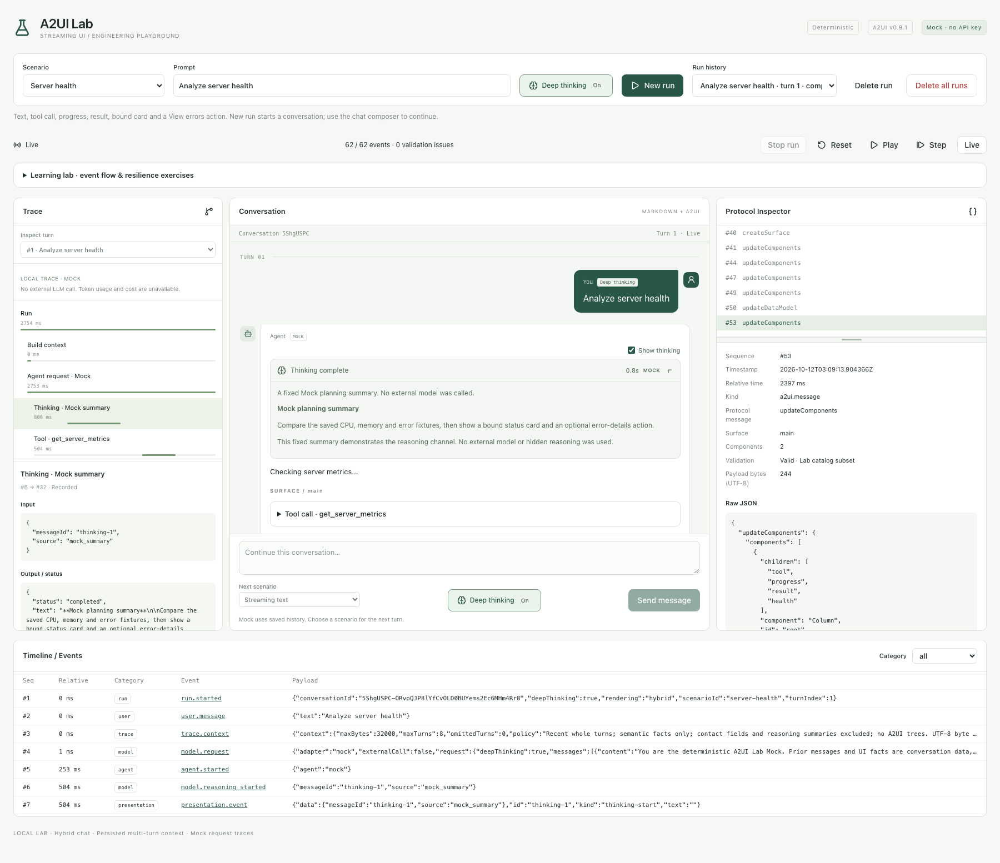

# 可开关的思考摘要

[English](thinking.md) | [简体中文](thinking_zh.md)

Deep thinking 是每次请求的应用选项。当前在 9 个场景中启用固定的 Mock 规划摘要，
随后仍按原场景输出正文与组件。它没有调用真实模型，也不代表模型内部的私有思维链。



## 页面操作

- 新建 Run 按钮旁的 **Deep thinking** 控制这次新运行是否生成思考摘要。
- 聊天输入区的同一开关控制下一轮。两处共用当前选项，但不会改写已经提交的
  请求或历史。刷新页面后偏好默认关闭，每轮已提交的值独立保存。
- 思考流式输出时，面板默认展开，显示状态图标、来源与耗时；结束后自动折叠。
  若用户手动展开/折叠，后续增量与结束状态保留该选择。支持键盘操作。
- 每条 Agent 气泡内的 **Show thinking** 可隐藏/显示思考面板，正文不变，
  不删除事件。展开及显示偏好属于本地 UI 状态。
- 停止或失败会保存已收到的思考摘要并标记 interrupted/failed。
  正常结束却缺少思考完成事件时，显示 incomplete 和诊断，不冒充完整思考。
- Trace 增加 Thinking 节点，Learning lab 增加相应事件检查点。
  刷新与回放读取持久化事件，不重新生成摘要。

## 请求与事件契约

```json
{
  "prompt": "Analyze server health",
  "scenarioId": "server-health",
  "deepThinking": true
}
```

POST /api/runs 的 deepThinking 可省略，默认 false；追问另带会话与父 Run ID。
后端将该值写入 agent.Request、实际 model.request 快照和 run.started。
提交后修改开关只影响下一次请求，旧事件不改写。

OpenAI 兼容预览仍只显示 messages；完整 deepThinking 应在原始 Mock 快照中查看。
这不是任何供应商通用的 reasoning 参数，更不是已经发出的外部 HTTP 请求。

```json
[
  {"kind":"model.reasoning_started","payload":{"messageId":"thinking-1","source":"mock_summary"}},
  {"kind":"model.reasoning_delta","payload":{"messageId":"thinking-1","text":"A displayable summary fragment."}},
  {"kind":"model.reasoning_completed","payload":{"messageId":"thinking-1"}}
]
```

以上是语义消息示例，入库后增加 id、runId、seq 与 timestamp。
每个思考阶段使用 Run 内唯一 messageId。来源支持 mock_summary 和 provider_summary；
后者是为模型适配预留的标准化入口，目前没有真实 Provider 实现。

## 分层职责

| 层 | 职责 |
| --- | --- |
| Agent | 按开关产生可展示摘要；正文仍用 model.text_delta |
| Service | 按事件种类和 messageId 缓冲；切换通道、生命周期或终止前刷出尾部 |
| Presentation | 映射为 thinking-start / thinking-delta / thinking-end，独立于 A2UI |
| A2UI | 思考不创建 Surface 或组件 |
| 聊天 reducer | 按保存顺序定位各阶段，使用连续前缀去重，诊断非法来源和生命周期 |
| Thinking 控件 | 安全 Markdown、展开/折叠、显示开关、记录的耗时及减少动态效果支持 |
| 上下文构造 | 只读取正文与允许的业务事实，默认排除思考摘要 |

每个通道/消息的首片立即保存，后续沿用 50ms / 128 字符缓冲。
通道切换先刷新，避免摘要与正文串在一起；停止也保存已收到的尾部。
model.response 分开记录正文 outputCharacters 与摘要 reasoningCharacters，
均为字符数，不伪造 token 或费用。耗时由事件时间戳推导，
完成/终止后冻结，回放不会启动新的计时器。

## 后续真实模型适配

1. deepThinking 只是应用对可展示推理内容的请求。适配器应根据具体模型的官方能力，
   再映射到对应参数，不能当成所有 OpenAI 兼容接口都有的标准字段。
2. 只将供应商实际公开用于展示的内容映射为 provider_summary。
   不为填充面板而虚构摘要或请求私有思维链。模型内部推理不意味着一定返回可展示内容。
3. 流式摘要映射为 start/delta/completed；一次性摘要也可使用同样生命周期。
   工具调用前后有多个思考阶段时，使用新 ID；最终回答继续走正文通道。
4. 只在实际结束时标记完成；取消/错误保留收到的前缀，由持久化状态解释界面。
5. 若供应商续接需要不透明状态，未来保存在适配器运行时/检查点边界内，
   不把展示摘要直接拼进多轮 messages。

思考沿用已有安全 Markdown：不执行传入 HTML/代码，不加载嵌入的远程图片，
链接受协议过滤。摘要保存在本地并可检查；排除后续上下文不等于删除历史或通用脱敏。

## 代码与验证入口

- [事件类型](../internal/event/event.go)、[Mock 摘要](../internal/agent/mock/reasoning.go)
- [缓冲与持久化](../internal/modules/lab/service.go)、[上下文策略](../internal/modules/lab/context.go)
- [纯 reducer](../web/src/lib/reasoning.ts)、[交互控件](../web/src/features/lab/thinking.tsx)
- [Go 测试](../internal/modules/lab/reasoning_test.go)、[reducer 测试](../web/src/lib/reasoning.test.ts)、
  [组件测试](../web/src/features/lab/thinking.test.tsx)、[浏览器测试](../tests/e2e/thinking.spec.ts)
- [架构决策 ADR 0013](decisions/0013-optional-thinking-summaries.md)

执行 make fmt、make test、make verify。验证覆盖各场景开关、停止尾部保存、
独立字符统计、上下文隔离、多阶段顺序、异常诊断、键盘、刷新/回放和窄屏。
不需要数据库迁移或模型凭据。
